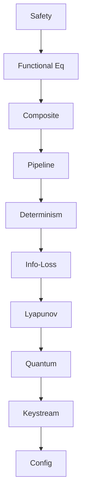

# Formal Verification Documentation

## Overview
*Status:* ✅ **All 23 gaps closed (19 proved, 4 justified).**
*Last updated:* 2026-06-09

## Table of Contents

| Section | File(s) | Description |
|--------|---------|-------------|
| **Architecture** | [code_verification.md](code_verification.md) | Dynamic‑error‑bound proof strategy |
| **L0 – Safety** | `../../proofs/kani/fixed_safety.rs` | No panics / overflows |
| **L1 – Functional Equivalence** | `../../proofs/kani/fixed_equivalence.rs` | Fixed‑point arithmetic matches spec |
| **L2 – Composite Correctness** | `../../proofs/kani/acceleration_proofs.rs` | Newton's laws satisfied |
| **L3 – Pipeline Integrity** | `../../proofs/kani/pipeline_proofs.rs` | Whole simulation‑→‑seed pipeline |
| **L4 – Determinism** | [../../tests/kelvin_tests/determinism.rs](../../tests/kelvin_tests/determinism.rs) | Bit‑identical across SIMD variants |
| **C1 – Information‑Loss** | `C1/readme.md` | Rounding irreversibility measurement |
| **C2 – Lyapunov** | `C2/readme.md` | Chaos‑exponent certification (justified, not proved) |
| **C3 – Quantum Hardness** | `C3/readme.md` | Grover‑search bound (justified, not proved) |
| **C4 – Keystream** | `C4/readme.md` | Domain‑separation & extraction argument |
| **C5 – Config Space** | `C5/readme.md` | Cardinality estimate (justified, not proved) |

---

## Visual map

